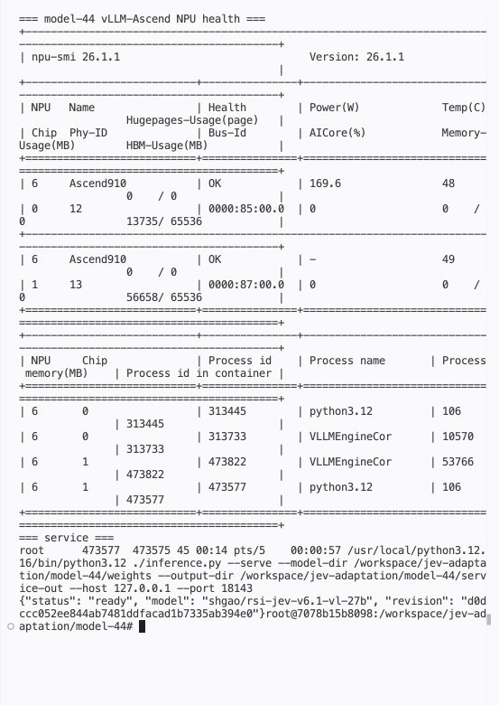
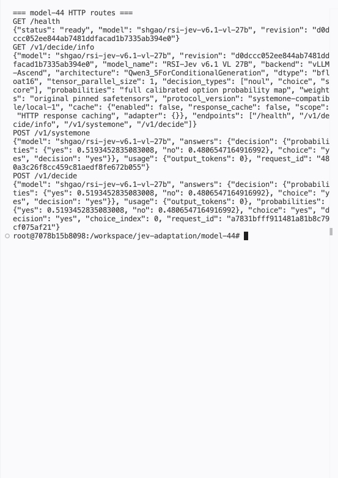
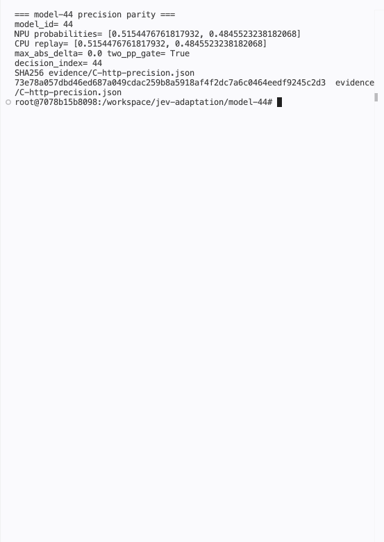

# RSI-Jev v6.1 VL 27B (model-44)

This repository packages the model-44 vLLM-Ascend adapter and its reproducible evidence. The pinned upstream checkpoint is `shgao/rsi-jev-v6.1-vl-27b` at revision `d0dccc052ee844ab7481ddfacad1b7335ab394e0`. Checkpoint tensors are deliberately excluded from this public repository; provide the original model directory with `--model-dir` when running the service. The exact five-file weight manifest and SHA256 values remain in [`lfs-manifest.json`](lfs-manifest.json) and [`evidence/B-weight-manifest.json`](evidence/B-weight-manifest.json).

The small `.pt` files under `evidence/` and `service-out/` are captured final hidden-state tensors used for scorer replay evidence; they are not checkpoint or model-weight files.

## Runtime

The validated environment is vLLM-Ascend 0.30.0, CANN 9.2.1, Ascend910/A3, and BF16. The loader milestone used TP2; the resident decision service uses TP1 on Ascend910 chip1. The real pinned tokenizer is retained under [`source-audit/`](source-audit/), including `tokenizer.json`, `tokenizer_config.json`, `chat_template.jinja`, and the preprocessing configuration.

The service has four HTTP endpoints:

- `GET /health`
- `GET /v1/decide/info`
- `POST /v1/systemone`
- `POST /v1/decide`

Start it on an Ascend host with:

```bash
bash start.sh --model-dir /path/to/rsi-jev-v6.1-vl-27b --output-dir /path/to/run-evidence
```

`--model-dir` must expose the original checkpoint tensors, including `scorer.safetensors`, `aux_scorers.safetensors`, and `calibration.safetensors` under either the directory itself or a `weights/` child. `start.sh` keeps the CANN/vLLM-Ascend environment setup from the validated host and resolves the package path relative to the script.

## What is verified

The package preserves real NPU hidden-state captures, the option-span encoder, the typed RSI-Jev scorer, and the HTTP run in `evidence/`. `evidence/C-real-decision-ready.json` records a real-tokenizer, real-NPU, 45-token yes/no probe with calibrated main, aux48, and aux56 probabilities. `evidence/C-http-precision.json` records the same real tokenization/hidden capture replayed through the CPU scorer: both NPU HTTP and CPU replay return `[0.5154476761817932, 0.4845523238182068]`, so the maximum absolute probability delta is exactly `0.0`. This is scorer replay parity over a captured NPU hidden state; it is not an independent CPU tower inference.

The four routes and complete option maps are evidenced by [`evidence/C-http-service.log`](evidence/C-http-service.log) and the service output files. The historical wrapper blocker receipt is retained for audit chronology; later C-stage evidence supersedes its earlier “not run” status. No official baseline precision comparison or official submission score is claimed. The 2PP gate belongs to the tuning track; the adaptation track requires a runnable NPU deployment and the standard public materials.

Three model-44-specific terminal captures are included under `assets/`: NPU health and resident vLLM-Ascend process, all four HTTP routes, and NPU/CPU scorer-replay parity with the evidence SHA. They were captured from the live remote VS Code code-server terminal while model-44 was running on openlibing-vllm8 chip 1. The older model-102 captures remain quarantined under [`evidence/legacy-model102-assets/`](evidence/legacy-model102-assets/) and are not used as submission assets.







The machine-readable release record is [`MODEL_MANIFEST.json`](MODEL_MANIFEST.json).

## Source and evidence layout

- `service_adapter.py`, `service_runtime.py`, `inference.py`, `start.sh`: model-44 resident adapter and transport.
- `native-plugin/`: option-span encoding, hidden-state capture contract, and scorer implementation.
- `source-rsi-jev/`: upstream RSI-Jev source snapshot at commit `e58526f061afd4c383d33a22b309b888f8a3e3c7` (embedded Git metadata removed for the release package).
- `source-audit/`: pinned tokenizer/config audit files used by the real run.
- `evidence/`: environment, NPU loader, real hidden-state, scorer replay, HTTP, precision, and SHA256 receipts.
- `vllm-base-probe/`: non-weight probe helpers and index metadata; checkpoint files are supplied by `--model-dir`.

The complete remote-to-staging receipt is [`evidence/REMOTE-SOURCE-SHA256SUMS.txt`](evidence/REMOTE-SOURCE-SHA256SUMS.txt). It covers the pulled non-weight source/evidence tree and deliberately excludes `weights/`, transient `staging/`, and Python bytecode.

## License

Apache-2.0. See [`LICENSE`](LICENSE) and [`CITATION.cff`](CITATION.cff).
